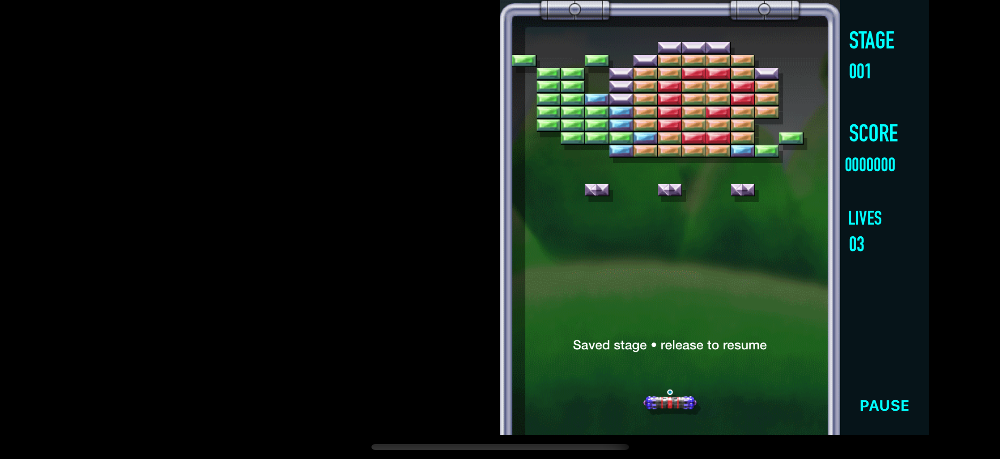

# Blasterball for iOS

A personal, unofficial UIKit and SpriteKit reconstruction of Blasterball for iPhone, iPad, and Duo. The project brings together BB2 Revolution, Remix, and Holidays, with an evolving BB3 implementation, original artwork and audio, and layouts for different screen sizes.

*Simulator image from build 9; the current development build may look different.*

## Current build

Version **0.7.9, build 27** includes full-width Duo cover gameplay, a laptop control deck aligned with the playfield, revised enemy effects, and BB2/BB3 game resources. The owner confirmed the cover-screen fix on Duo. See [release notes](ios/RELEASE-0.7.9.md) for validation and remaining limits.

## Build and install

The iOS project and source are in [`ios/`](ios/). Open `ios/Blasterball.xcodeproj` in Xcode or inspect `ios/build.sh`; signing and an appropriate Apple development setup are required. The release IPA is provided for personal use and needs signing before installation.

## Credits

This is an independent personal project, not an official WildTangent release. Original game artwork, audio, and names belong to their respective owners. This public repository contains original game resources. Their inclusion does not grant redistribution rights or a license from their owners.
