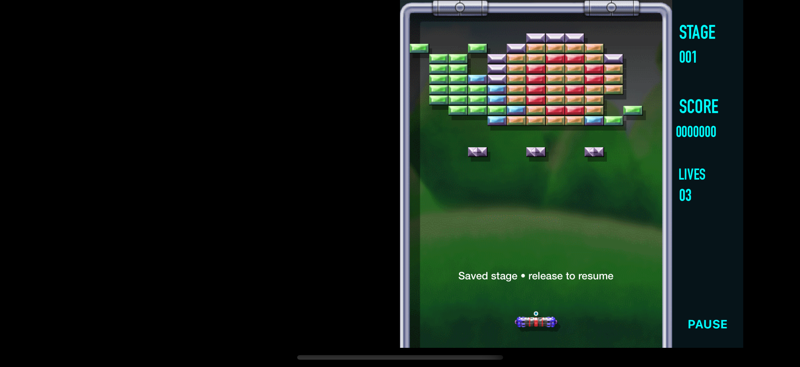

# Blasterball for iOS

A personal, unofficial UIKit and SpriteKit reconstruction of Blasterball for iPhone, iPad, and Duo. The project brings together BB2 Revolution, Remix, and Holidays, with an evolving BB3 implementation, original artwork and audio, and layouts for different screen sizes.

*Simulator image from build 9; the current development build may look different.*

## Current build

Version **0.6.4, build 17** includes BB2 and BB3 work, a pause menu, adaptive presentation, and original game resources. BB3 campaign fidelity and some audio behavior remain in progress. This build was installed on Duo without being launched; physical gameplay and layout are not verified for this build. See [release notes](ios/RELEASE-0.6.4.md) for the recorded scope.

## Build and install

The iOS project and source are in [`ios/`](ios/). Open `ios/Blasterball.xcodeproj` in Xcode or inspect `ios/build.sh`; signing and an appropriate Apple development setup are required. The release IPA is provided for personal use and needs signing before installation.

## Credits

This is an independent personal project, not an official WildTangent release. Original game artwork, audio, and names belong to their respective owners. This repository is private because it contains original game resources.
